most of what i build stays private. not because it is secret, it is just genuinely messy lol. so here is the short version.

the most ambitious thing i do for fun is automating everything in my homelab: about 40 self-hosted apps in 80 containers that deploy, patch and watch themselves. they range from apps you probably use too, to helpers for my ai itself, to custom ones i built to make my own life easier. it all runs on one minisforum ms-a2 (ryzen 9, 16 cores) behind a fortigate, with unifi for the network.

for lunch money i manage and improve websites for local businesses.

genuinely down for any cool project. hit me up: [hi@djr.sh](mailto:hi@djr.sh)
